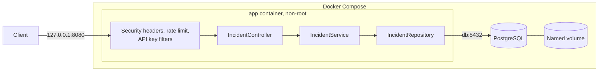
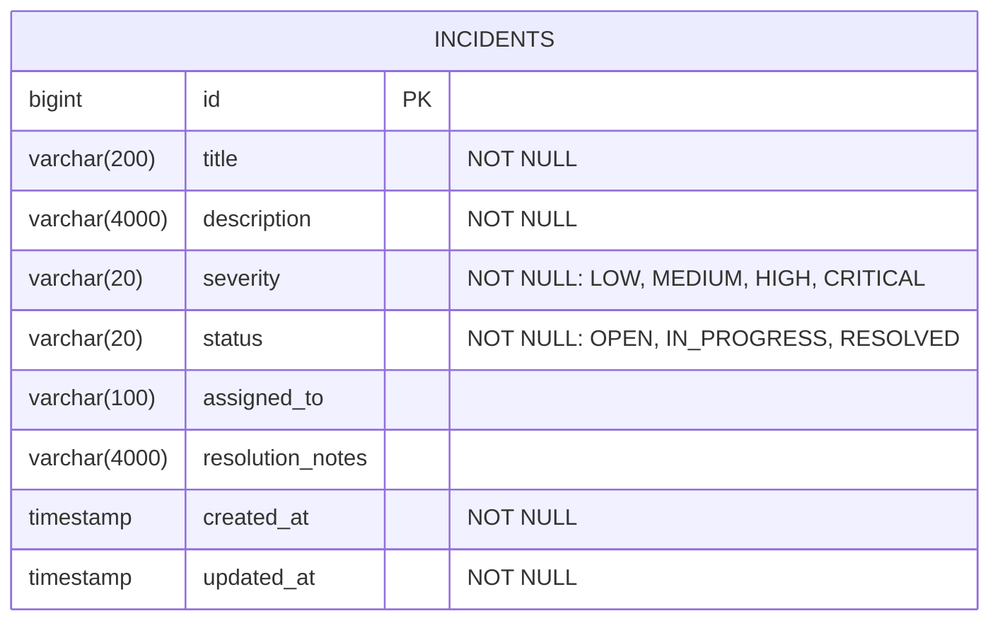

# OpsTrack: DevOps Incident Management System

[](https://github.com/faiqarifbillah/opstrack-devops-incident-management/actions/workflows/ci.yml)

A secured Spring Boot REST API for recording and managing IT incidents, packaged with Docker and PostgreSQL and tested through GitHub Actions.

**Project status:** runs locally in Docker Compose, with CI on GitHub Actions. It is **not deployed to AWS**. A [deployment guide](docs/AWS_DEPLOYMENT.md) documents how it could be, and those steps have not been run.

## Problem statement

When an application goes down or a database connection fails, teams need one reliable record of what happened, how severe it is, who owns it and how it was resolved. OpsTrack provides that record through a small, secured API.

## Objectives

- Build a realistic REST API with Java and Spring Boot.
- Store data in PostgreSQL, running in Docker.
- Protect the API with authentication and rate limiting, and handle secrets safely.
- Verify behaviour with automated tests and continuous integration.
- Practise diagnosing real failures with Linux and Docker tools.

## Technology stack

| Area | Technology |
|---|---|
| Language | Java 17 |
| Framework | Spring Boot 4.1, Spring Web MVC, Spring Data JPA, Bean Validation, Actuator |
| Database | PostgreSQL 17; H2 in memory for automated tests only |
| Build | Maven (through the Maven Wrapper) |
| Containers | Docker, Docker Compose |
| Testing | JUnit, MockMvc, AssertJ, Postman |
| CI | GitHub Actions |

## System architecture

A single monolithic application, with a layered design:



Each request first passes the rate limiter, so repeated API key guesses are limited too. It then passes the API key check, followed by input validation.

## Features

- Create, read, update and delete incidents, and filter them by status or severity.
- Input validation, with field-level errors and consistent JSON error responses.
- `X-API-Key` authentication with constant-time comparison.
- Configurable per-client rate limiting, returning 429 and `Retry-After`.
- Refuses to start with a missing or short API key.
- Public health endpoint that shows only `UP` or `DOWN`.
- Security headers on application responses.
- Non-root containers, a database user without superuser rights, and no published database port.

## Database design



## API endpoints

All `/api/**` endpoints require the `X-API-Key` header.

| Method | Path | Purpose | Success |
|---|---|---|---|
| POST | `/api/incidents` | Create an incident | 201 |
| GET | `/api/incidents` | List all incidents | 200 |
| GET | `/api/incidents/{id}` | Get one incident | 200 |
| PUT | `/api/incidents/{id}` | Replace an incident | 200 |
| DELETE | `/api/incidents/{id}` | Delete an incident | 204 |
| GET | `/api/incidents/status/{status}` | Filter by status | 200 |
| GET | `/api/incidents/severity/{severity}` | Filter by severity | 200 |
| GET | `/actuator/health` | Health check, no key needed | 200, or 503 if unhealthy |

Common errors are `400` for invalid input, `401` for a missing or wrong key, `404` for an unknown incident, and `429` over the rate limit.

### Sample request and response

```bash
curl -i -X POST http://localhost:8080/api/incidents \
  -H "X-API-Key: $KEY" -H "Content-Type: application/json" \
  -d '{"title":"Payment API returning 500","description":"Spike in server errors","severity":"CRITICAL","assignedTo":"On-call engineer"}'
```

```json
{
  "id": 1,
  "title": "Payment API returning 500",
  "description": "Spike in server errors",
  "severity": "CRITICAL",
  "status": "OPEN",
  "assignedTo": "On-call engineer",
  "resolutionNotes": null,
  "createdAt": "2026-11-01T12:22:48.209754400Z",
  "updatedAt": "2026-11-01T12:22:48.209754400Z"
}
```

Invalid input returns `400`, naming each problem:

```json
{
  "timestamp": "2026-11-01T12:29:22.817092Z",
  "status": 400,
  "error": "Bad Request",
  "message": "Validation failed",
  "path": "/api/incidents",
  "fieldErrors": {
    "severity": "severity is required",
    "description": "description is required"
  }
}
```

## Installation

You need Docker with Docker Compose. JDK 17 is only needed to run the tests outside Docker.

```bash
git clone https://github.com/faiqarifbillah/opstrack-devops-incident-management.git
cd opstrack-devops-incident-management
cp .env.example .env
```

Replace every `change-me` in `.env` with a separate value from `openssl rand -hex 32`. See [SECURITY.md](SECURITY.md) for details and a Windows alternative.

## Docker

```bash
docker compose up --build -d
docker compose ps
curl http://localhost:8080/actuator/health
```

Expect both containers to show `healthy` once started, and `{"status":"UP"}`. The first build can take over 10 minutes. See the [Docker guide](docs/DOCKER_GUIDE.md) for commands and troubleshooting.

## Testing

```bash
./mvnw clean verify
```

On Windows PowerShell, use `.\mvnw.cmd clean verify`. This runs 44 automated tests using an in-memory H2 database, with no `.env` file needed. PostgreSQL behaviour was checked separately by running the Postman collection against the Docker stack.

For manual testing, see [Testing the API](docs/API_TESTING.md) and the [Postman collection](postman/OpsTrack.postman_collection.json).

## CI workflow

[`.github/workflows/ci.yml`](.github/workflows/ci.yml) runs on pushes to `main` and on every pull request:

1. Checks out the code.
2. Sets up Java 17.
3. Runs `./mvnw -B -ntp verify` to compile, test and package.
4. Builds the Docker image.
5. Uploads test reports if something failed, and reports the result.

The workflow uses read-only repository permissions. It does not deploy anything, so this is continuous integration rather than continuous deployment.

## Linux troubleshooting examples

Each of these was reproduced on purpose and then fixed. The [Linux guide](docs/LINUX_GUIDE.md) has the commands and practice labs.

| Symptom | Evidence | Cause |
|---|---|---|
| Application unreachable | `curl` exit 7, status `Exited (143)` | Application stopped |
| Requests hang | `curl` exit 28, status `Paused` | Process frozen |
| Stack will not start | `port is already allocated` | Another container holds the port |
| Crash loop | Uptime far shorter than container age | Invalid API key configuration |
| Health check `DOWN` | `password authentication failed` in database logs | Wrong database password |
| Health check `503` | `bad address 'db'` | Database container stopped |

## AWS deployment

Not deployed. The [AWS deployment guide](docs/AWS_DEPLOYMENT.md) covers EC2, Security Groups, Parameter Store, HTTPS, costs and removing resources.

## Security

See [SECURITY.md](SECURITY.md) for the design, secret handling and limitations. The application serves plain HTTP, so any real deployment needs HTTPS in front of it.

## Known limitations

- One shared API key, with no per-user identity or roles.
- Rate limit counts are in memory, so they reset on restart and do not work across several instances. Behind a proxy they need trusted proxy configuration.
- `GET /api/incidents` has no pagination.
- Hibernate's `ddl-auto: update` manages the schema, instead of versioned migrations.
- Automated tests use H2, not PostgreSQL.
- No automated database backups.

## Future improvements

- Run automated tests against PostgreSQL with Testcontainers.
- Add database migrations with Flyway.
- Add pagination and an audit history of incident changes.
- Add user accounts and roles with Spring Security.
- Add metrics and dashboards with Prometheus and Grafana.
- Add continuous deployment, and deploy to AWS.

## Documentation

- [Docker guide](docs/DOCKER_GUIDE.md)
- [Linux operations and troubleshooting](docs/LINUX_GUIDE.md)
- [Testing the API](docs/API_TESTING.md)
- [AWS deployment guide](docs/AWS_DEPLOYMENT.md)
- [Security design and secrets](SECURITY.md)
- [Git workflow](docs/GIT_GUIDE.md)
