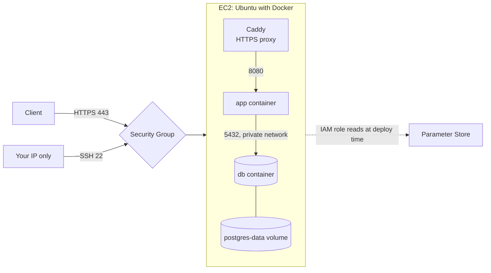

# AWS deployment guide

> **Status: documented, not deployed.** OpsTrack is not live on AWS, and the steps below have not been run against a real AWS account. Expect to adjust them. Review the costs before you create anything.

## What EC2 is

Amazon EC2 rents virtual servers, called instances. You choose an operating system image, a size and a region, then manage it much like any Linux machine. You pay while it runs, plus for attached storage and some networking, whether or not anyone is using the application.

## Target architecture



Only ports 80 and 443 are open to the public. PostgreSQL and the application's port are never exposed.

## Costs

Check every figure with the [AWS Pricing Calculator](https://calculator.aws/) before you start, because prices vary by region and change over time. These are rough estimates from November 2026, for a server left running all month in Singapore (`ap-southeast-1`):

| Item | Approximate cost | Notes |
|---|---|---|
| `t3.small` instance, 2 GiB memory | US$0.026 per hour, about US$19 per month | Third-party listing. Confirm on the AWS price page |
| Public IPv4 address | US$0.005 per hour, about US$3.65 per month | Charged whether in use or idle |
| 20 GB gp3 disk | Roughly US$2 per month | Estimate. Confirm the regional rate |
| Parameter Store, standard parameters | Normally no charge | Confirm for your usage |
| **Total** | **Roughly US$25 per month** | Before tax |

Possible further charges include data transfer, snapshots and a domain name.

**Free plan:** new AWS accounts can receive up to US$200 in credits and start on a Free plan, which AWS says will not charge you unless you convert to a Paid plan. It covers selected services and ends when the credits run out or after 6 months. Existing or previous AWS customers may not qualify. Do not assume a resource is free: check the terms and your Billing console.

**Stopping is not deleting.** A stopped instance stops the hourly compute charge, but its disk continues to cost money, and so can an Elastic IP.

### Budgets and billing alerts

Before creating resources, go to **Billing → Budgets** and create a monthly cost budget with email alerts, for example at 50% and 100% of US$10.

AWS Budgets **is not a spending cap**. It sends a notification, and it does not stop resources or charges. Billing data can also lag by hours, so charges may be higher than the alert suggests.

## 1. Protect the account

1. Turn on multi-factor authentication for the root user, and stop using root for daily work.
2. Create an administrative user through IAM Identity Center or IAM.
3. Set up the budget above.

Never store AWS access keys in this repository or in application code. On EC2, an IAM role provides temporary credentials instead.

## 2. Store secrets in Parameter Store

Generate new values for production. Do not reuse your local ones. Using AWS CloudShell avoids saving them on your computer:

```bash
aws ssm put-parameter --name /opstrack/prod/OPSTRACK_API_KEY  --type SecureString --value "$(openssl rand -hex 32)"
aws ssm put-parameter --name /opstrack/prod/DB_PASSWORD       --type SecureString --value "$(openssl rand -hex 32)"
aws ssm put-parameter --name /opstrack/prod/DB_ADMIN_PASSWORD --type SecureString --value "$(openssl rand -hex 32)"
```

Create an IAM role for the EC2 instance with least privilege. It needs `ssm:GetParameter` on `arn:aws:ssm:<region>:<account-id>:parameter/opstrack/prod/*`, and `kms:Decrypt` on the key that protects them if you use a customer-managed key.

## 3. Create the Security Group

| Type | Port | Source | Purpose |
|---|---|---|---|
| SSH | 22 | **Your IP**, shown as `x.x.x.x/32` | Administration |
| HTTP | 80 | `0.0.0.0/0` | HTTPS certificate challenge and redirect |
| HTTPS | 443 | `0.0.0.0/0` | API traffic |

**Do not add rules for 5432 or 8080.** Your home IP can change, so update the SSH rule if you get locked out. Security Groups block all other inbound traffic by default.

AWS Systems Manager Session Manager is a stronger alternative, because it needs no open SSH port.

## 4. Launch the instance

Create an instance in the console with:

- **Image:** a current Ubuntu LTS
- **Type:** `t3.small`. Docker, Java and PostgreSQL together are tight in 1 GiB of memory
- **Key pair:** create one and store the `.pem` file outside this repository
- **Security Group and IAM role:** from the previous steps
- **Disk:** 20 GB gp3

This step starts the charges.

From your computer, restrict the key and connect:

```bash
chmod 400 opstrack-key.pem
ssh -i opstrack-key.pem ubuntu@<public-ip>
```

## 5. Install Docker

Follow Docker's official [Ubuntu installation guide](https://docs.docker.com/engine/install/ubuntu/) to install Docker Engine and the Compose plugin. Then:

```bash
sudo usermod -aG docker ubuntu
exit
```

Connect again, then check that it works:

```bash
docker run --rm hello-world
systemctl status docker
```

Be aware that membership of the `docker` group is effectively root access.

Install the AWS CLI by following the [AWS installation guide](https://docs.aws.amazon.com/cli/latest/userguide/getting-started-install.html).

## 6. Deploy

```bash
git clone https://github.com/faiqarifbillah/opstrack-devops-incident-management.git
cd opstrack-devops-incident-management
```

Write `.env` from Parameter Store, with permissions set first:

```bash
umask 077
get() { aws ssm get-parameter --name "/opstrack/prod/$1" --with-decryption --query Parameter.Value --output text; }
cat > .env <<EOF
OPSTRACK_API_KEY=$(get OPSTRACK_API_KEY)
DB_USERNAME=opstrack
DB_PASSWORD=$(get DB_PASSWORD)
DB_ADMIN_PASSWORD=$(get DB_ADMIN_PASSWORD)
APP_PORT=8080
EOF
```

Then start the stack and check it:

```bash
docker compose up --build -d
docker compose ps
curl http://127.0.0.1:8080/actuator/health
```

The API still binds to `127.0.0.1`, so it is not yet reachable from outside.

## 7. Add HTTPS

**The API key must not travel over plain HTTP.** Getting a trusted certificate requires a domain name pointing at the server.

Install Caddy by following its [official guide](https://caddyserver.com/docs/install), then set `/etc/caddy/Caddyfile`, which fetches and renews a certificate automatically:

```text
api.example.com {
    reverse_proxy 127.0.0.1:8080
}
```

```bash
sudo systemctl reload caddy
curl https://api.example.com/actuator/health
```

**Rate limiting needs attention here.** Behind a proxy, every client appears to come from the proxy's address, so all clients share one limit. Fix this before relying on the limiter: configure trusted proxy handling, such as `SERVER_FORWARD_HEADERS_STRATEGY=native`, and verify that clients cannot spoof `X-Forwarded-For`. Add HSTS at the proxy as well.

## 8. Check availability and logs

```bash
curl -i https://api.example.com/actuator/health
curl -i https://api.example.com/api/incidents
docker compose ps
docker compose logs --tail 100 app
sudo journalctl -u caddy -n 50
df -h
free -h
```

Expect `200` with `UP`, then `401` without a key. See [LINUX_GUIDE.md](LINUX_GUIDE.md) for troubleshooting.

From another network, confirm that these are **not** reachable: ports 5432 and 8080.

## 9. Stop or remove everything

To pause compute charges, stop the instance. Storage and possibly address charges continue.

To stop charges from this deployment, remove the resources:

1. Terminate the instance.
2. Check **EC2 → Volumes** and delete leftover volumes. Termination does not always remove every disk.
3. Check **EC2 → Snapshots** and delete any you made.
4. Check **EC2 → Elastic IPs** and release any.
5. Delete the Security Group and key pair if you no longer need them.
6. Delete the `/opstrack/prod/*` parameters and the IAM role.
7. Delete the DNS record if you made one.
8. Check **Billing → Bills** for your resources in **every region you used**, and again over the next few days, because charges appear late.

## Known gaps

- Database data lives on one server, with no automated backups. Production needs tested backups, or a managed database such as Amazon RDS.
- Deployment is manual. There is no continuous deployment.
- There is no central monitoring or alerting.
- Running one server means no high availability.

## References

- [AWS Free Tier](https://aws.amazon.com/free/) and [Free Tier FAQs](https://aws.amazon.com/free/free-tier-faqs/)
- [Amazon VPC pricing](https://aws.amazon.com/vpc/pricing/), which includes public IPv4
- [AWS Pricing Calculator](https://calculator.aws/)
- [DoiT `t3.small` listing for Singapore](https://www.doit.com/compute/spot/ap-southeast-1/t3.small), a third-party source
