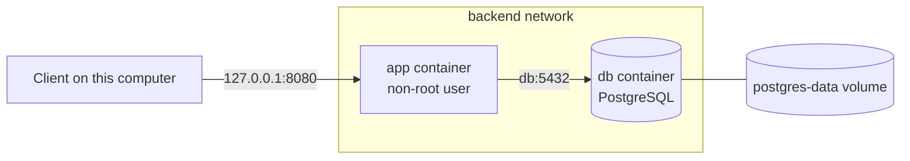

# Docker guide

## How it fits together



- **Image:** a read-only package of an application and what it needs. The `Dockerfile` describes how to build it.
- **Container:** a running instance of an image. Containers can be deleted and recreated.
- **Volume:** storage that outlives containers. This is why database data survives.
- **Network:** lets containers reach each other by service name, which is why the application connects to `db:5432`.

## First start

Copy the example file, then replace every `change-me`. Generate each value with `openssl rand -hex 32`. The application refuses to start with the placeholder API key.

```bash
cp .env.example .env
docker compose up --build
```

The first build can take over 10 minutes because it downloads images and every dependency. Later builds reuse Docker's cache. Success looks like:

```text
app-1  | ... Started OpsTrackApplication in 5.366 seconds
```

In a second terminal:

```bash
curl http://localhost:8080/actuator/health
```

Expected: `{"status":"UP"}`. Press `Ctrl+C` to stop. Use `docker compose up --build -d` to run in the background instead.

## Everyday commands

| Command | What it does |
|---|---|
| `docker compose up --build -d` | Build and start in the background |
| `docker compose ps` | List containers and their health |
| `docker compose logs -f app` | Follow application logs; `Ctrl+C` stops following only |
| `docker compose logs --tail 50 db` | Show the last 50 database log lines |
| `docker compose restart app` | Restart one service |
| `docker compose stop` | Stop containers and keep them |
| `docker compose down` | Remove containers and the network, and keep data |
| `docker compose down -v` | **Also deletes the database volume and all its data** |

## Inspecting

| Command | What it shows |
|---|---|
| `docker images` | Images on this computer |
| `docker network ls` | Networks |
| `docker network inspect <project>_backend` | Containers attached to a network |
| `docker volume ls` | Volumes |
| `docker volume inspect <project>_postgres-data` | Volume details |
| `docker inspect --format "{{.State.Health.Status}}" <container>` | One container's health |
| `docker stats --no-stream` | CPU and memory use |
| `docker compose exec app id` | Which user the application runs as |
| `docker compose exec db psql -U opstrack -d opstrack` | Open a database shell; `\dt` lists tables and `\q` exits |

`<project>` is the Compose project name, by default the folder name.

`docker inspect` shows a container's environment variables, including secrets, so do not paste its full output anywhere.

## Troubleshooting

| Symptom | Likely cause | What to do |
|---|---|---|
| `Set DB_PASSWORD in .env` | `.env` is missing or incomplete | Create it from `.env.example`, in the same folder as `docker-compose.yml` |
| `app` keeps restarting | Often a placeholder or short API key | `docker compose logs app`, and look for `OPSTRACK_API_KEY must be set` |
| `port is already allocated` | Another program uses the port | Free the port or change `APP_PORT` in `.env`, then run `docker compose down` and `docker compose up -d`. See [LINUX_GUIDE.md](LINUX_GUIDE.md) |
| `password authentication failed` | `DB_PASSWORD` changed after the volume was created | See below |
| `/actuator/health` returns 503 `DOWN` | The database is unreachable | `docker compose ps`, then `docker compose logs db` |
| `Cannot connect to the Docker daemon` | Docker Desktop is not running | Start it and wait for the engine to run |

### Changing the database password

`docker/postgres/init-app-user.sh` runs only when the volume is first created, so editing `DB_PASSWORD` later does not change the password stored in the database.

Keep your data by changing it in the database, then update `.env` to match and run `docker compose up -d`:

```bash
docker compose exec db psql -U postgres -c "ALTER ROLE opstrack PASSWORD 'new-password'"
```

If the data does not matter, `docker compose down -v` deletes it, and the next start creates everything again.

## Design decisions

- **Multi-stage build:** the JDK, Maven and source code stay in the build stage. The final image holds only a JRE and the jar.
- **Non-root containers:** the application runs as user `opstrack`, limiting what an attacker could do after compromising it.
- **Separate database users:** the application's user owns its database but has no superuser rights. The `postgres` administrator is used only for setup.
- **No published database port:** PostgreSQL is reachable only from the Compose network.
- **API bound to `127.0.0.1`:** only this computer can reach it. Production also needs HTTPS in front.
- **`depends_on` with `service_healthy`:** the application waits until the database accepts connections, not merely until its container has started.
